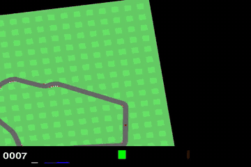

# CarRacing AI Challenge

Training an AI driver for Gymnasium `CarRacing-v3` to complete laps as fast as possible.

See [journal.md](journal.md) for the development log.

## Results



*v2 `best.pt` on track 202 (13.7 s lap). Full videos of v1, v2 and v3 on 202 → 42 → 203 are
attached to the [release](https://github.com/nisbenz/max-verstappen/releases/tag/model-v2).*

**Submitted model:** [`carracing_v2_best.pt`](https://github.com/nisbenz/max-verstappen/releases/download/model-v2/carracing_v2_best.pt)
(see [How the organizer runs the submitted model](#how-the-organizer-runs-the-submitted-model)).

Lap times with the official protocol (DNF = 70 s), PyTorch default thread count:

| Model | 202 | 42 | 203 | Mean |
| --- | --- | --- | --- | --- |
| v1 | 13.82 s | 15.32 s | 38.98 s | 22.71 s |
| **v2 (submitted)** | **13.68 s** | **15.14 s** | 39.10 s | **22.64 s** |
| v3 | 20.66 s | 15.56 s | DNF | 35.41 s |

On 50 unseen random tracks (seeds 2000–2049, the best proxy for the mystery round):

| Model | Mean lap | Median lap | DNF | Mean return |
| --- | --- | --- | --- | --- |
| v1 | 25.8 s | 20.8 s | 3/50 | 864 |
| v2 | 23.6 s | 16.2 s | 3/50 | 872 |
| v3 | 22.2 s | 16.3 s | 2/50 | 890 |

On 203, v2 cuts the last corner before the finish and has to drive a second lap to touch the
missed tiles: see [journal.md](journal.md) for why, and what was tried.

## Approach (draft v0)

- **Input:** the last 4 frames, grayscale, stacked → `4 × 96 × 96`.
- **Network:** CNN (3 conv layers + 512 fully connected), with two heads:
  - **actor:** one Beta distribution per action;
  - **critic:** V(s), the expected discounted return.
- **Algorithm:** PPO (clip 0.2, GAE λ = 0.95, γ = 0.99) with Adam, on the GPU.
  Rewards are divided by the running std of the discounted return; the learning rate decays to 10%.
  Training uses 16 parallel envs on random tracks.
- **Checkpoint choice:** `best.pt` is the best greedy driver on 12 validation seeds (1000–1011),
  evaluated on CPU like the organizer. 202 / 42 / 203 are only logged, never used to choose.
- **Action repeat:** each decision is held for 4 frames.
- **Reward:** the env's own reward only (+1000/N per new tile, −0.1 per frame), γ = 0.998.
  v1/v2 used shaping penalties (grass, stuck, missed tiles, steering); they are still available
  as `train.py` options, off by default. See [journal.md](journal.md) for why they were dropped.

| File | Role |
| --- | --- |
| `carracing/wrappers.py` | preprocessing, action repeat, frame stack, reward shaping |
| `carracing/model.py` | CNN actor-critic with Beta heads |
| `carracing/train.py` | PPO loop, logging (`runs/<run>/log.csv`), checkpoints |
| `carracing/driver.py` | the submitted model: raw frame in, `[steer, gas, brake]` out |
| `carracing/evaluate.py` | runs the official protocol on 202 / 42 / 203 |
| `carracing/fast_render.py` | faster drawing for training envs, pixel-identical to the official renderer |
| `scripts/check_fast_render.py` | proves the fast renderer gives bit-identical frames, rewards and endings |

## Usage

```bash
uv sync
uv run python -m carracing.train --run-name v1          # 8M agent steps, ~6 h
uv run python -m carracing.train --run-name v1b --init runs/v1/best.pt   # continue training
uv run python -m carracing.evaluate runs/v0/best.pt     # official protocol
uv run python -m carracing.evaluate runs/v0/best.pt --render --seeds 202
```

`pyproject.toml` pins the ROCm 7.2 build of PyTorch, for training on an AMD RX 6750 XT
(`train.py` sets `HSA_OVERRIDE_GFX_VERSION=10.3.0` for it). Evaluation needs no GPU:
checkpoints are saved on CPU, and any PyTorch ≥ 2.x build can run them.

## Actions: how the model's output becomes a valid env action

The policy outputs **2** numbers in `[0, 1]` (Beta samples), not 3:

| Policy output | Mapping | Env action |
| --- | --- | --- |
| `a[0]` | `steer = 2·a[0] − 1` | steering in `[-1, 1]` |
| `a[1]` | `throttle = clip((2·a[1] − 1) / 0.7, −1, 1)` | `gas = max(throttle, 0)`, `brake = max(−throttle, 0)` |

Gas and brake share one axis, so the car can never press both pedals at once. The `/ 0.7`
gain lets the pedals saturate (full gas at `a[1] ≥ 0.85`): the driver uses the Beta mean,
which never reaches 1, so with a plain linear mapping v0 never went above 0.76 gas.

During training, the wrapper skips drawing the 3 frames of each action repeat that the
agent never sees (drawing is ~80% of a CarRacing step). Physics and rewards are unchanged,
and evaluation always uses the normal env.

**Is this allowed?** Yes. Section 6 of the guidelines requires that the env receives continuous `[steering, gas, brake]` with steering in `[-1, 1]` and gas and brake in `[0, 1]`. It explicitly allows a different internal action format, as long as it is converted at inference ("If you trained with discrete actions, convert them to the continuous format during inference"). Our conversion is a fixed formula, not a driving rule: every decision still comes from the network. It happens inside the submitted model (`Driver`), so the organizer always receives a valid 3-value action.

## How the organizer runs the submitted model

`best.pt` is a full `Driver` module. It does all the preprocessing itself: grayscale, the 4-frame stack, the 4-frame action repeat and the action mapping. The official loop works unchanged, with `action = model(obs)` on the raw `(96, 96, 3)` frame:

```python
import sys; sys.path.insert(0, "path/to/this/repo")   # so the Driver class can be unpickled
import gymnasium as gym, torch

model = torch.load("best.pt", weights_only=False)
model.eval()

env = gym.make("CarRacing-v3", max_episode_steps=3000)
obs, _ = env.reset(seed=202)
done, info = False, {}
while not done:
    action = model(obs)                    # numpy [steer, gas, brake]
    obs, reward, terminated, truncated, info = env.step(action)
    done = terminated or truncated
lap_time = env.unwrapped.t if info.get("lap_finished", False) else None
```

Notes for the organizer:

- **`weights_only=False` is required** with PyTorch ≥ 2.6. Since 2.6, `torch.load` defaults to `weights_only=True` and refuses to load any full model, from any participant.
- **The model is stateful** (it keeps the last 4 frames). Load it fresh for each run, as the reference script does, or call `model.reset()` before a new run.
- The model only uses the image it receives. It never reads `env.unwrapped`.
